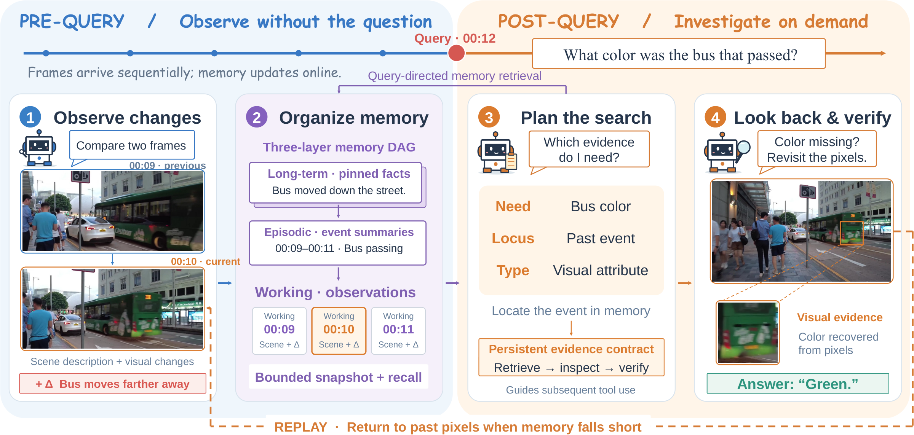
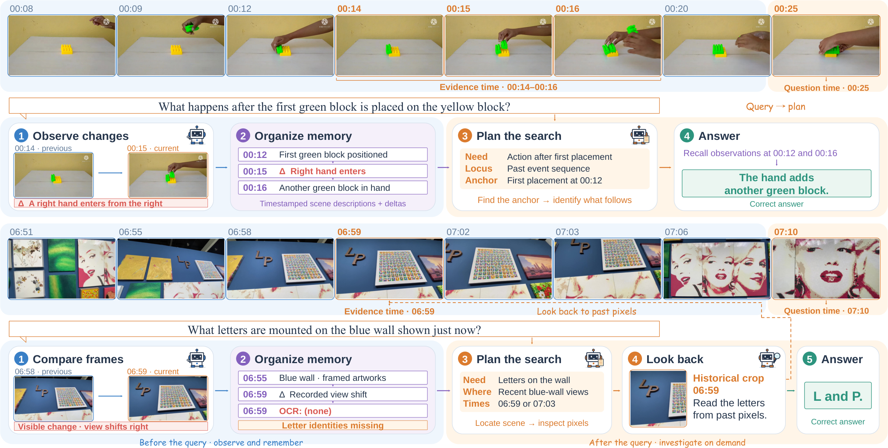

<div align="center">


### Towards Human-Like Agentic Streaming Video Understanding

[**Boyuan Sun**](https://bbbbchan.github.io)<sup>1</sup> · [**Deshui Miao**](https://yahooo-m.github.io/)<sup>2</sup> · **Wenzhao Gao**<sup>2</sup> · **Shaoyong Jia**<sup>2</sup> · **Shaohui Jiao**<sup>2</sup><br>
**Chi Liu**<sup>3</sup> · **Yan Shu**<sup>3</sup> · **Derek Li**<sup>3</sup> · **Bryan Dai**<sup>3</sup> · **Shengsheng Qian**<sup>4</sup> · [**Qibin Hou**](https://houqb.github.io/)<sup>1</sup>

<sup>1</sup> VCIP, Nankai University<br>
<sup>2</sup> ByteDance Inc. &emsp; <sup>3</sup> IQuest Research<br>
<sup>4</sup> Institute of Automation, Chinese Academy of Sciences

[](https://bbbbchan.github.io/DeltaStreamer/)
[](https://arxiv.org/pdf/2610.19849)
[](https://huggingface.co/papers/2610.19849)
[](https://github.com/BBBBchan/AI-Tongdan)
[](https://b23.tv/dHFBXjO)
[](https://www.xiaohongshu.com/discovery/item/6ad0626c0000000014003273?source=webshare&xhsshare=pc_web&xsec_token=ABEw_n4nzssF438oECyiP-Ab8_Gk-5lGvClzGSTnyKviI=&xsec_source=pc_share)

[](LICENSE)


**[Overview](#overview) · [Getting Started](#getting-started) · [Evaluation](#evaluation) · [Deploy Interactive Demo](demo/README.md) ·[Results](#results) · [Citation](#citation)**

</div>

> **Application released:** [AI同担 (AI-Tongdan)](https://github.com/BBBBchan/AI-Tongdan) is a livestream companion built on DeltaStreamer, with continuous observation, contextual Q&A, and danmaku suggestions.

## Overview

**DeltaStreamer** is an agentic framework for streaming video understanding inspired by how humans observe, remember, and investigate. Video frames arrive over time, while a later question may depend on a detail that was not retained during observation. DeltaStreamer connects **change-aware memory** with **query-driven planning and targeted visual replay**, allowing the system to investigate beyond its stored descriptions.

> Observe the stream, remember what happened, and revisit the visual evidence when memory falls short.

<div align="center">
  
</div>

### Highlights

| Component | What it does |
| --- | --- |
| **Explicit visual deltas** | Compare consecutive frames and retain their changes alongside scene descriptions, making event transitions explicit. |
| **Structured textual memory** | Organize observations, episode summaries and pinned facts in a hierarchical DAG, with entity indexing and pointers to source evidence. |
| **Query-driven planning and replay** | Identify the evidence a question needs, guide subsequent retrieval and tool use, and revisit historical frames when visual details are missing. |

The release contains the inference implementation, preparation scripts and scoring tools for **OVO-Bench** and **StreamingBench**. It requires no additional training to run the agent with a supported local VLM checkpoint.

### Qualitative Examples

The first example uses recorded changes to recover an action sequence. In the second, the planner locates an earlier scene and requests historical visual evidence to read letters missing from textual memory.

<div align="center">
  
</div>


## Getting Started

### 1. Installation

Run the following commands from the repository root, in a separate Python environment. The source environment uses **Python 3.10+, PyTorch 2.10.0, vLLM 0.19.1 and transformers 5.5.4**, with NVIDIA GPUs. FFmpeg is required for media preparation and audio extraction.

```bash
python -m venv .venv
source .venv/bin/activate
python -m pip install --upgrade pip

# Install PyTorch wheels matching your CUDA environment.
python -m pip install torch==2.10.0 torchvision==0.25.0 torchaudio==2.10.0 \
  --index-url https://download.pytorch.org/whl/cu126

python -m pip install -r requirements.txt
python scripts/setup_runtime.py
```

`setup_runtime.py` downloads official **ms-swift 4.2.0** and applies the inference compatibility file in `compat/` to an isolated `.runtime/` directory. This preserves the current per-response tool-call generation limit without changing installed packages. Use this runtime when launching the agent.

### 2. Model and Tool Checkpoints

Prepare the following checkpoints separately:

| Checkpoint | Use | How to provide it |
| --- | --- | --- |
| **Qwen3.6-27B** | Visual observation, planning and answering | `--model /models/Qwen3.6-27B` |
| **SAM2.1 Hiera Large** | Object tracking | `--sam2-checkpoint /models/sam2.1_hiera_large.pt` |
| **Whisper base** | Audio transcription | Downloaded on first use into `checkpoints/whisper/` |

For offline use, cache Whisper weights before running. Model weights and benchmark videos are not included in this repository.

### 3. Prepare Benchmarks

Download the datasets from their official releases:

- **[OVO-Bench](https://github.com/JoeLeelyf/OVO-Bench)** — [video downloads](https://huggingface.co/datasets/JoeLeelyf/OVO-Bench).
- **[StreamingBench](https://github.com/THUNLP-MT/StreamingBench)** — follow the official dataset download instructions.

For OVO-Bench, place `ovo_bench_new.json`, `src_videos/` and the official `chunked_videos/` under your data directory. The script expands timestamped forward tasks, extracts 1 fps frames and prepares full-source ASI inputs.

```bash
python scripts/prepare_ovobench.py \
  --data-root /data/OVO-Bench --jobs 8
```

Use `--annotation /path/to/annotation.json` for a different annotation location. If only source videos are available, add `--video-mode source`.

For StreamingBench, point to the extracted official CSV files and video directories:

```bash
python scripts/prepare_streamingbench.py \
  --source-root /data/StreamingBench-source \
  --output-root /data/StreamingBench --jobs 8
```

Both scripts support `--check-only`. Keep original videos available for replay and ASR. Prepared annotations contain local frame paths; regenerate them or update the paths if you move the data.

## Evaluation

### OVO-Bench

```bash
CUDA_VISIBLE_DEVICES=0 python run.py \
  --benchmark ovobench \
  --model /models/Qwen3.6-27B \
  --data-root /data/OVO-Bench \
  --sam2-checkpoint /models/sam2.1_hiera_large.pt \
  --output outputs/ovo
```

### StreamingBench

```bash
CUDA_VISIBLE_DEVICES=0 python run.py \
  --benchmark streamingbench \
  --model /models/Qwen3.6-27B \
  --data-root /data/StreamingBench \
  --sam2-checkpoint /models/sam2.1_hiera_large.pt \
  --output outputs/streamingbench
```

Each run uses one shared-queue worker with concurrent samples. To use tensor parallelism, expose two GPUs and add `--tp 2`. Outputs include result JSONL, per-sample trajectories, a resolved run configuration and `metrics.json`.

| Option | Purpose |
| --- | --- |
| `--tp 2` | Distribute the model across two visible GPUs. |
| `--concurrency 4` | Reduce concurrent samples from the default of 12. |
| `--dataset /path/to/subset.json` | Run an already-prepared subset. |
| `--tasks EPM,HLD` | Restrict evaluation to selected tasks. |
| `--resume` | Continue an existing output directory with the same model, data and settings. |
| `--dry-run` | Inspect the command without loading models or writing outputs. |
| `--no-audio`, `--no-track` | Explicitly disable ASR or tracking; these change the evaluated system. |

Completed IDs are skipped on resume. The default configuration checks for a SAM2 checkpoint. Whisper provides ASR; speaker identification and audio-event adapter interfaces retain neutral fallbacks in this implementation.

### Scoring

Scoring can run separately without a model or GPU:

```bash
python scripts/score_ovobench.py outputs/ovo \
  --dataset /data/OVO-Bench/ovobench_streamo_eval_asi_full.json \
  --require-complete --strict

python scripts/score_streamingbench.py outputs/streamingbench \
  --dataset /data/StreamingBench/streamingbench_streamdelta_eval.json \
  --require-complete --strict
```

OVO-Bench reports per-task scores and task-macro group averages. StreamingBench uses sample-level accuracy, with content and timing checks for proactive output. The scripts also audit missing, duplicate and malformed records. When running selected tasks, use a matching subset annotation for strict completeness checks.


## Interactive Demo

Upload your own video, choose when to ask a question, and inspect the agent's observations, visual deltas, structured memory, plan and answer in an English or Chinese interface. The demo uses the repository's agent with either a locally served vision model or a remote OpenAI-compatible vision API.

**[Deployment guide](demo/README.md) · [中文部署说明](demo/README.zh-CN.md)** — model download, local/API configuration, video upload and interactive questions are documented in the independent `demo/` folder.


## Results

Overall scores reported in the current manuscript:

| Method | OVO-Bench | StreamingBench |
| --- | ---: | ---: |
| **DeltaStreamer** | **66.07** | **59.53** |

These are paper-reported results, not measurements from a new run of this release. The release has passed syntax, command-line and focused behavior checks; full GPU inference regression has not yet been completed.

## Project Structure

```text
DeltaStreamer/
├── assets/                   # Paper framework and qualitative examples
├── configs/                  # OVO-Bench and StreamingBench profiles
├── core/
│   ├── agent.py              # Observation, delta, planning and evidence loop
│   ├── worker.py             # Shared-queue inference worker
│   ├── video_processor.py    # Streaming inputs and benchmark helpers
│   └── tools/                # Memory, replay, verification, crop, tracking, ASR
├── compat/swift/             # Inference compatibility file for ms-swift
├── demo/                     # Upload UI, HTTP model adapter, deployment guides
├── scripts/
│   ├── setup_runtime.py
│   ├── prepare_ovobench.py
│   ├── prepare_streamingbench.py
│   ├── score_ovobench.py
│   └── score_streamingbench.py
├── run.py                    # Unified evaluation entry point
├── requirements.txt
├── SOURCE_MANIFEST.json      # Provenance and hashes of retained source files
└── LICENSE
```

### Core Code Guide

| Component | Code |
| --- | --- |
| Observation and query-driven planning | [`core/agent.py`](core/agent.py) |
| Memory events, salience and context rendering | [`core/tools/memory.py`](core/tools/memory.py) |
| Memory DAG and entity indexing | [`core/tools/memory_graph.py`](core/tools/memory_graph.py) |
| Consistency checking and replay scheduling | [`core/tools/verification.py`](core/tools/verification.py) |
| Historical frame replay | [`core/tools/temporal.py`](core/tools/temporal.py) |
| Visual crop, tracking and ASR | [`spatial.py`](core/tools/spatial.py), [`track.py`](core/tools/track.py), [`audio.py`](core/tools/audio.py) |
| Inference settings | [`ovobench.json`](configs/ovobench.json), [`streamingbench.json`](configs/streamingbench.json) |

This compact release preserves the current inference decisions, prompts and memory formulas, including compatibility branches and benchmark-specific verification switches. The profiles expose these settings explicitly. The legacy `STREAMO_*` environment names are retained for compatibility. Multi-worker cluster orchestration, training code and experiment artifacts are excluded.

## Citation

If you find this work useful, please cite:

```bibtex
@article{sun2026deltastreamer,
  title   = {DeltaStreamer: Towards Human-Like Agentic Streaming Video Understanding},
  author  = {Sun, Boyuan and Miao, Deshui and Gao, Wenzhao and Jia, Shaoyong and
             Jiao, Shaohui and Liu, Chi and Shu, Yan and Li, Derek and Dai, Bryan and
             Qian, Shengsheng and Hou, Qibin},
  journal = {arXiv preprint arXiv:2610.19849},
  year    = {2026},
  url     = {https://arxiv.org/abs/2610.19849}
}
```

## License

DeltaStreamer is licensed under [CC BY-NC 4.0](LICENSE). The ms-swift compatibility code retains its [Apache-2.0 license](compat/LICENSE) and ModelScope copyright notices. Bundled Manrope fonts retain their [SIL Open Font License](demo/static/fonts/Manrope-OFL.txt). Third-party dependencies, models and datasets remain subject to their own licenses.

## Contact

For questions about the implementation, please feel free to open an issue in this repository, or contact me at `sbysbysby123@gmail.com`.

## Acknowledgements

We thank [ms-swift](https://github.com/modelscope/ms-swift), [vLLM](https://github.com/vllm-project/vllm), [SAM2](https://github.com/facebookresearch/sam2) and [Whisper](https://github.com/openai/whisper), and the authors of [OVO-Bench](https://github.com/JoeLeelyf/OVO-Bench) and [StreamingBench](https://github.com/THUNLP-MT/StreamingBench) for their open-source contributions.
